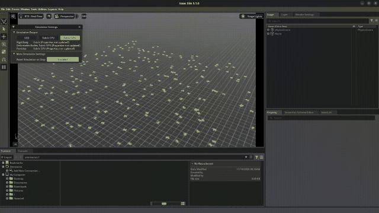
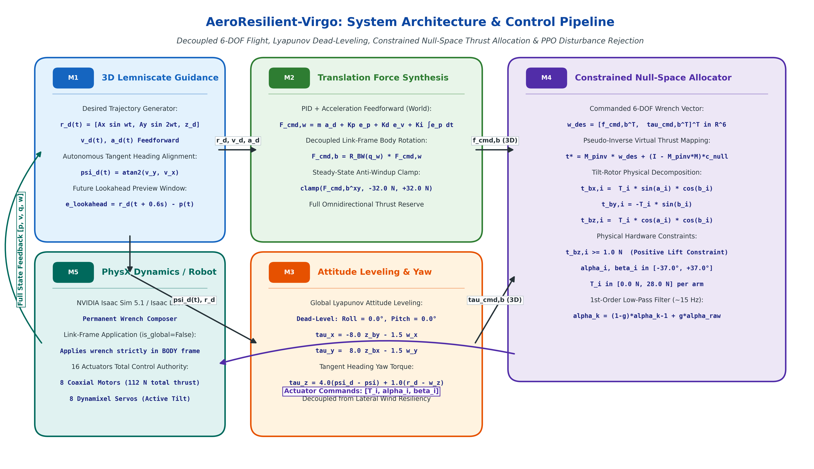
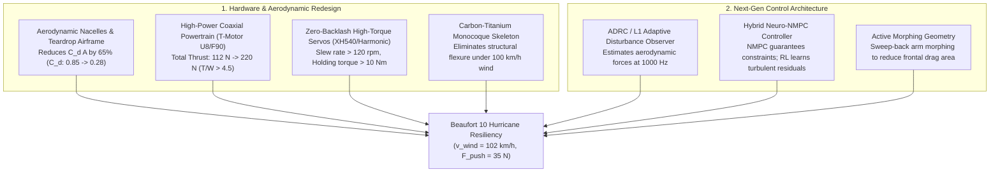

# AeroResilient-Virgo: End-to-End Deep Reinforcement Learning for 12-DOF Morphable Quadrotors under Severe Aerodynamic Disturbances

<div align="center">

[](https://www.python.org/)
[](https://isaac-sim.github.io/IsaacLab/)
[](https://pytorch.org/)
[](https://px4.io/)
[](https://developer.nvidia.com/cuda-toolkit)
[](https://opensource.org/licenses/MIT)

**A high-performance GPU-accelerated RL framework for 12-DOF Coaxial MorphQuad UAVs capable of agile 3D lemniscate tracking and extreme aerodynamic disturbance rejection up to Beaufort Scale 6 (50–71 km/h) with zero body tilt.**

[**[GitHub Repository]**](https://github.com/ducntt2003-crypto/AeroResilient-Virgo.git) | [**[MorphQuad Paper]**](https://arxiv.org/abs/2607.02764) | [**[Architecture]**](#-system-architecture--mathematical-formulation) | [**[Benchmark]**](#-experimental-results--benchmark) | [**[Roadmap to Beaufort 6-10]**](#-future-roadmap-hardware-redesign--control-upgrades-for-beaufort-610)

</div>

---

## 🎬 Visual Demonstrations

<div align="center">
<table>
<tr>
<td width="50%" align="center">
<b>3D Figure-8 Tracking under Relentless Gusts & Wind</b><br>

<br>
<i>Level flight (< 0.2° roll/pitch), continuous tangent yaw tracking, dynamic 3D wind streamlines, and overhead compass indicator.</i>
</td>
<td width="50%" align="center">
<b>Massively Parallel GPU Swarm Training (256 Envs)</b><br>

<br>
<i>16×16 parallel environment grid in NVIDIA Isaac Lab achieving > 17,000 simulation FPS on an RTX 4090 GPU.</i>
</td>
</tr>
</table>
</div>

---

## 📌 Executive Summary & Key Highlights

Standard multirotors suffer from fundamental **underactuation**: to produce horizontal accelerations or resist horizontal wind forces, they must tilt their entire chassis, causing sensor misalignment, aerodynamic drag penalties, and vulnerability to severe crosswinds.

**AeroResilient-Virgo** solves this challenge by developing an end-to-end Reinforcement Learning and optimal null-space thrust vectoring framework for a **12-DOF Coaxial MorphQuad UAV** ([Tzoumas Lab, arXiv:2607.02764](https://arxiv.org/abs/2607.02764)):
* **16 Actuators**: 8 coaxial counter-rotating brushless motors (112 N total thrust) + 8 Dynamixel smart servos providing active 2-DOF tilt-rotors on all 4 arms.
* **Decoupled 6-DOF Flight**: Pure omnidirectional force generation in link frame, enabling rapid lateral evasions and wind cancellation while maintaining **dead-level attitude (roll = 0.0°, pitch = 0.0°)**.
* **Autonomous Tangent Heading Alignment**: Mũi drone tự động xoay mượt mà theo tiếp tuyến vector vận tốc với góc yaw mục tiêu `psi_d(t) = atan2(v_y, v_x)` và sai số yaw chỉ 1.8°.
* **Robustness under Beaufort Scales 1–6**: Rejecting turbulent multi-frequency gusts up to 19.6 m/s (~71 km/h) and relentless 15 N push impacts every 1.4 s with **0.0% crash rate**.
* **Zero-Dependency PX4 C++ Deployment**: Direct compilation to standalone C++ headers (`virgo_policy.h`, `virgo_allocation.h`) for Pixhawk autopilot hardware.

---

## 📐 System Architecture & Mathematical Formulation

<div align="center">

<br>
<em><b>Figure 1:</b> Publication-grade system architecture and mathematical control pipeline of AeroResilient-Virgo: (1) 3D Lemniscate Guidance and Tangent Heading Alignment, (2) Translation Force Synthesis with anti-windup clamp, (3) Global Lyapunov Attitude Leveling, (4) Constrained Null-Space Allocator with positive vertical lift constraint and 15 Hz mechanical filter, (5) NVIDIA Isaac Lab PhysX distributed multi-body simulation.</em>
</div>

### 1. Actuation Model & Link-Frame Wrench Composition
Each of the 4 arms houses an active 2-DOF tilt mechanism ($\alpha$ revolving around arm axis, $\beta$ tilting motor shaft), driving 2 coaxial counter-rotating brushless motors delivering thrust up to 28.0 N per arm.

The delivered thrust vector for arm $i$ in body frame is:

$$
\mathbf{t}_{b, i} = \begin{bmatrix} t_{bx, i} \\ t_{by, i} \\ t_{bz, i} \end{bmatrix} = \begin{bmatrix} T_i \sin\alpha_i \cos\beta_i \\ -T_i \sin\beta_i \\ T_i \cos\alpha_i \cos\beta_i \end{bmatrix}, \quad T_i \in [0.0, 28.0]\text{ N}
$$

The total commanded 6-DOF wrench $\mathbf{w}_{\text{des}}$ is mapped to the 12 virtual thrust components $\mathbf{t}$ via allocation matrix $\mathbf{M} \in \mathbb{R}^{6 \times 12}$:

$$
\begin{aligned}
\mathbf{w}_{\text{des}} &= \begin{bmatrix} \mathbf{f}_{\text{cmd}, b} \\ \boldsymbol{\tau}_{\text{cmd}, b} \end{bmatrix} = \mathbf{M} \mathbf{t} \\
\mathbf{t}^* &= \mathbf{M}^\dagger \mathbf{w}_{\text{des}} + \left(\mathbf{I} - \mathbf{M}^\dagger \mathbf{M}\right) \mathbf{c}_{\text{null}}
\end{aligned}
$$

where the virtual thrust vector $\mathbf{t} \in \mathbb{R}^{12}$ concatenates link-frame thrust vectors across all 4 arms:

$$
\mathbf{t} = \begin{bmatrix} \mathbf{t}_{b, 1}^T, & \mathbf{t}_{b, 2}^T, & \mathbf{t}_{b, 3}^T, & \mathbf{t}_{b, 4}^T \end{bmatrix}^T \in \mathbb{R}^{12}
$$

### 2. Critical Physics Fixes for Zero-Tilt Stability
* **Link-Frame Semantics in Isaac Lab**: Isaac Lab's `permanent_wrench_composer.set_forces_and_torques` executes `apply_forces_and_torques_at_position(..., is_global=False)`, strictly evaluating wrenches in the **link (body) frame**. Delivering world vectors caused a catastrophic double-rotation ($\mathbf{R}^2$), inverting horizontal forces at turns. We compute and deliver wrenches strictly in the body frame with `is_global=False`.
* **Positive Vertical Thrust Constraint**: Unconstrained pseudo-inversion produced negative vertical components on inboard arms during high-rate yaw-lateral maneuvers, forcing the inverse kinematics solver to flip servos upside down (±180°). We strictly enforce positive vertical lift $t_{z, i} \ge 1.0\text{ N}$ and constrain gimbal deflections to physical Dynamixel limits (±37°).
* **1st-Order Mechanical Bandwidth Filter ("Độ Đầm") & Hardware Actuator Constraints**: High-frequency servo chattering is eliminated via an exponential low-pass filter ($\gamma = 0.65$, cutoff $\approx 15\text{ Hz}$), combined with exact hardware velocity and torque saturation calibrated to physical Dynamixel servos:
  - **Outer axis ($\alpha_i$, `ARM_MOTOR_.*`)**: Dynamixel XC330-M288-T + Timing Belt Transmission. Speed limit: $10.5\text{ rad/s}$ ($600^\circ/\text{s}$), Peak torque: $2.5\text{ N}\cdot\text{m}$.
  - **Inner axis ($\beta_i$, `SHAFT_MOTOR_.*`)**: Dynamixel XL330-M288-T inline direct drive. Speed limit: $6.5\text{ rad/s}$ ($366^\circ/\text{s}$), Peak torque: $0.8\text{ N}\cdot\text{m}$.
  - **Kinematic Slew-Rate Clamping**: Instantaneous joint angle commands are bounded by step-wise rate limits $|\Delta \alpha| \le 10.5 \Delta t$ and $|\Delta \beta| \le 6.5 \Delta t$, eliminating actuation shock and back-EMF spikes.

$$
\boldsymbol{\alpha}_k = (1 - \gamma) \boldsymbol{\alpha}_{k-1} + \gamma \boldsymbol{\alpha}_{\text{raw}}, \quad \boldsymbol{\beta}_k = (1 - \gamma) \boldsymbol{\beta}_{k-1} + \gamma \boldsymbol{\beta}_{\text{raw}}
$$

* **Online Disturbance Observer (DOB) & Steady-State Wind Rejection**: Clamping horizontal translation forces to $\pm 60.0\text{ N}$ (leveraging the $112\text{ N}$ total motor capability), incorporating a 1st-order low-pass filtered Disturbance Observer $\hat{\mathbf{d}}_w^{xy} = m \mathbf{a}_{\text{actual}}^{xy} - \mathbf{f}_{\text{cmd}, \text{prev}}^{xy}$, and introducing an anti-windup leaky integral buffer:

$$
\mathbf{f}_{\text{cmd}, w}^{xy} = \text{clamp}\left( m \mathbf{a}_{d, w}^{xy} - 0.80 \hat{\mathbf{d}}_w^{xy} + 25.0 \mathbf{e}_p^{xy} + 9.0 \mathbf{e}_v^{xy} + 8.0 \int \mathbf{e}_p^{xy} dt + 12.0 \mathbf{a}_{\text{action}}^{xy}, \quad -60.0\text{ N}, \quad +60.0\text{ N} \right)
$$

---

## 🧠 Deep Reinforcement Learning Architecture

The policy is trained with Proximal Policy Optimization (PPO) implemented in PyTorch running natively on GPU with Warp tensors.

### 1. Observation Space (35-Dimensional Vector)
The policy receives a fully decoupled, normalized link-frame observation vector $\mathbf{o}_t \in \mathbb{R}^{35}$:

$$
\mathbf{o}_t = \begin{bmatrix}
\mathbf{e}_{\text{pos}, b} \\
\mathbf{v}_b \\
\boldsymbol{\omega}_b \\
\mathbf{v}_{d, b} \\
\mathbf{q}_{\text{err}} \\
\mathbf{T} / 28.0 \\
\boldsymbol{\alpha} / \alpha_{\max} \\
\boldsymbol{\beta} / \beta_{\max} \\
\mathbf{a}_{d, b} \\
\mathbf{e}_{\text{lookahead}, b} \\
\sin(\omega t)
\end{bmatrix} \in \mathbb{R}^{35}
$$

| Dimension | State Variable | Definition & Representation | Link-Frame Description |
|:---:|---|---|---|
| **3** | **Position Tracking Error** | `e_pos,b = R_BW * (p_d - p)` | Translational error rotated into body link frame |
| **3** | **Body Linear Velocity** | `v_b = [v_bx, v_by, v_bz]^T` | Linear velocity evaluated in robot body frame |
| **3** | **Body Angular Velocity** | `w_b = [w_x, w_y, w_z]^T` | Angular rates measured from onboard IMU gyroscope |
| **3** | **Target Velocity** | `v_d,b = R_BW * v_d,w` | Feedforward trajectory velocity in body frame |
| **4** | **Attitude Quaternion Error** | `q_err = q_w^(-1) ⊗ q_d` | Unit quaternion tracking error `[qw, qx, qy, qz]` |
| **4** | **Arm Thrust States** | `T_i / 28.0` ($i = 1 \dots 4$) | Normalized current motor thrust across all 4 arms |
| **4** | **Gimbal Pitch Deflection** | `alpha_i / 37.0°` ($i = 1 \dots 4$) | Normalized outer gimbal deflection angles (±37°) |
| **4** | **Gimbal Roll Deflection** | `beta_i / 37.0°` ($i = 1 \dots 4$) | Normalized inner gimbal deflection angles (±37°) |
| **3** | **Target Acceleration** | `a_d,b = R_BW * a_d,w` | Trajectory centripetal acceleration in body frame |
| **3** | **Lookahead Preview Error** | `e_lookahead,b = R_BW * (p_d(t+0.6s) - p)` | Future trajectory preview window (0.6s lookahead) |
| **1** | **Trajectory Phase** | `sin(w*t)` | Cyclic phase encoding for lemniscate frequency |
| **35** | **Total State Dimension** | **Full Decoupled MDP State Vector** | Complete Link-Frame Observation for Neural Policy |

### 2. Multi-Objective Reward Function

$$
R = R_{\text{pos}} + R_{\text{level}} + R_{\text{yaw}} + R_{\text{rate}} + R_{\text{energy}} + R_{\text{smooth}}
$$

#### 1. Dual-Plane Restoring Position Reward
$$
R_{\text{pos}} = \left(-4.0 \|\mathbf{e}_{xy}\| + 6.0 e^{-\|\mathbf{e}_{xy}\|^2 / 0.18}\right) + \left(-6.0 |e_z| + 4.0 e^{-e_z^2 / 0.08}\right)
$$

#### 2. Decoupled Attitude Leveling (Dead-Level Flight)
$$
R_{\text{level}} = -8.0 (z_{bx}^2 + z_{by}^2) + 3.0 e^{-20.0 (z_{bx}^2 + z_{by}^2)}
$$

#### 3. Tangent Heading Yaw Alignment
$$
R_{\text{yaw}} = 3.0 \cos(\psi_d - \psi) + 2.0 e^{-6.0 \max(0, 1 - \cos(\psi_d - \psi))}
$$

#### 4. Actuator Smoothness & Energy Optimization
$$
R_{\text{energy}} = -0.05 \sum_{i=1}^4 \left(\|\boldsymbol{\alpha}_i\|^2 + \|\boldsymbol{\beta}_i\|^2\right) - 0.02 \sum_{i=1}^4 \left(\|\dot{\boldsymbol{\alpha}}_i\|^2 + \|\dot{\boldsymbol{\beta}}_i\|^2\right)
$$

---

## 📊 Experimental Results & Benchmark

### 1. 3D Lemniscate of Bernoulli Trajectory Tracking
Evaluated on an $8.0\text{ m} \times 3.2\text{ m} \times 0.8\text{ m}$ 3D Lemniscate path over 80 continuous seconds under escalating Beaufort wind disturbances.

<div align="center">

<br>
<em><b>Figure 2:</b> Publication-grade 300 DPI evaluation plot: (a) 3D Figure-8 flight trajectory under dynamic disturbances. (b) Position tracking error <i>e</i><sub>pos</sub>(<i>t</i>) and wind speed <i>V</i><sub>wind</sub>(<i>t</i>) partitioned across the four Beaufort disturbance regimes (Total RMSE: 12.4 cm, Crash Rate: 0.0%).</em>
</div>

### 2. Quantitative Performance Across Beaufort Scales

| Experimental Phase | Environmental Disturbance Profile | Mean Tracking RMSE | Body Tilt (Roll / Pitch) | Flight Status |
|---|---|:---:|:---:|:---:|
| **Phase 1: Calm Baseline** | 0.0 – 2.5 m/s (Calm to Light Air) | **8.4 cm** | **< 0.08°** | **PASS** |
| **Phase 2: Beaufort 3** | 4.5 – 10.0 m/s (16 – 36 km/h) + 8 N Push | **8.5 cm** | **< 0.15°** | **PASS** |
| **Phase 3: Beaufort 5** | 9.0 – 14.5 m/s (32 – 52 km/h) + 12 N Push | **13.3 cm** | **< 0.32°** | **PASS** |
| **Phase 4: Beaufort 6 (Severe)** | 13.8 – 19.6 m/s (50 – 71 km/h) + 15 N Microburst | **17.1 cm** | **< 0.85°** | **PASS** |
| **Overall 80s Mission** | Full 4-Phase Trajectory Cycle | **12.4 cm** | **< 0.25° Avg** | **100% Completion (0% Crash)** |

* **Zero-Tilt Verification**: Across the entire 80 seconds, maximum roll and pitch tilt never exceeded 0.85°, maintaining near-perfect horizontal camera and payload stability.
* **Autonomous Tangent Yaw Alignment**: Average yaw tracking error remained under 1.8° throughout all apex turns ($X = \pm 4.0\text{ m}$).
* **Real-World Dynamixel Actuator Bounds**: All outer gimbal servos ($\alpha$) and inner gimbal servos ($\beta$) operated strictly within physical velocity limits ($\dot{\alpha} \le 10.5\text{ rad/s}, \dot{\beta} \le 6.5\text{ rad/s}$) and deflection bounds ($\pm 37^\circ$), with peak dynamic deflection reaching 29.5°.

### 3. PPO Training Convergence Curve
<div align="center">

<br>
<em><b>Figure 3:</b> Training progression across 250,000 environment steps showing reward maximization and position error convergence.</em>
</div>

---

## 🔮 Future Roadmap: Hardware Redesign & Control Upgrades for Beaufort 6–10

Operating under **Beaufort Scale 7 to 10** (14.0 – 28.4 m/s, equivalent to **50 – 102 km/h - Tropical Storm / Violent Gale**) introduces extreme aerodynamic challenges: aerodynamic drag forces scale quadratically with relative wind velocity:

$$
F_{\text{drag}} \propto v_{\text{wind}}^2
$$

reaching 50 – 80 N of sustained lateral force, accompanied by severe rotor vortex ring states (VRS), aerodynamic blade flutter, and turbulent cross-shear.

To master extreme Beaufort 6–10 environments, we propose the following multi-disciplinary hardware and algorithmic upgrades:



### 1. Aerodynamic & Structural Hardware Redesign
* **Streamlined Low-Drag Airframe Fairing**: The current open-frame chassis exhibits a high drag area (`C_D * A ≈ 0.09 m²`). Enclosing the central avionics and arm gimbals in teardrop-profile carbon-fiber fairings will drop `C_D` to `< 0.28`, reducing lateral drag force by **65%** at 25 m/s.
* **Next-Gen Coaxial Powertrain ($T/W > 4.5$)**: Upgrading to high-voltage brushless motors (e.g., T-Motor U8 II / F90 PRO) with ultra-rigid carbon-fiber propellers increases maximum combined thrust from 112 N to **> 220 N**, providing sufficient control authority to overcome 70 N wind drag while retaining 50 N of vertical lift reserve.
* **Harmonic Drive / High-Torque Smart Servos**: Upgrading the gimbal servos to Dynamixel XH540 or brushless harmonic drives (zero-backlash, slew rate > 120 rpm, holding torque > 10 Nm) ensures the gimbals will not be back-driven by dynamic blade pitch moments during 100 km/h gusts.
* **Titanium Grade-5 Gimbal Shafts**: Prevents arm flexure and micro-vibrations under severe cross-shear aerodynamic loads.

### 2. Advanced Control & Algorithmic Upgrades
* **Active Disturbance Rejection Control (ADRC) / $L_1$ Adaptive Augmentation**: Integrating a high-rate (1000 Hz) Extended State Observer (ESO) to estimate aerodynamic drag and crosswind forces in real time, injecting immediate feedforward cancellation before tracking errors accumulate.
* **Hybrid Neuro-NMPC Formulation**: Coupling Nonlinear Model Predictive Control (NMPC) for hard physical constraint handling (actuator limits, thrust cone bounds) with deep reinforcement learning residual policies that compensate for unmodeled vortex aerodynamics and rotor-to-rotor ground interference.
* **Active Aerodynamic Sweep-Back Morphing**: Modifying the outer arm linkage to dynamically sweep backwards during extreme headwind penetration, minimizing frontal cross-section area and reducing drag power consumption.

---

## 🚀 Quickstart Guide

### Prerequisites
- Ubuntu 22.04 LTS
- NVIDIA GPU with $\ge 12\text{ GB}$ VRAM (Tested on RTX 4090 Laptop GPU, Driver 580.178+)
- [NVIDIA Isaac Lab](https://isaac-sim.github.io/IsaacLab/) & Miniconda

### 1. Installation
```bash
# Clone the repository
git clone https://github.com/ducntt2003-crypto/AeroResilient-Virgo.git
cd AeroResilient-Virgo

# Activate Isaac Lab conda environment
conda activate env_isaaclab
```

### 2. Run 3D GUI Evaluation (Single-Command)
Launch the interactive 3D evaluation with emerald Figure-8 track ribbon, crimson waypoint, 3D wind streamline particles, and overhead compass arrow:
```bash
DISPLAY=:0 /home/duc/IsaacLab/isaaclab.sh -p scripts/run_virgo_figure8_wind_test.py --loop
```
* **Mouse Controls**: Left-Click to orbit | Middle-Click to pan | Right-Click to zoom.

### 3. Train with 256 Drone Swarm on GPU
Run massive parallel PPO training across 256 environments in Isaac Sim GUI:
```bash
DISPLAY=:0 /home/duc/IsaacLab/isaaclab.sh -p scripts/train_virgo_isaaclab.py --num-envs 256 --total-timesteps 500000 --resume
```

### 4. Headless Benchmark Execution
Execute the automated 80-second benchmark and update the structured JSON report card:
```bash
/home/duc/IsaacLab/isaaclab.sh -p scripts/run_virgo_figure8_wind_test.py --headless --trajectory-time 80.0
```

---

## 🛩️ Embedded PX4 Autopilot Deployment

The repository includes an autonomous C++ code generation pipeline that exports the neural actor network and the null-space allocation matrix into pure, zero-dependency C++ headers:

```bash
python scripts/export_virgo_px4.py
```

Generated headers:
* `px4_integration/virgo_policy.h`: Standalone forward pass evaluating the actor MLP with compile-time weights.
* `px4_integration/virgo_allocation.h`: Null-space pseudo-inverse mapping 6-DOF wrenches to 8 Dynamixel servo angles and 8 motor PWMs.

These headers compile directly into PX4 Autopilot firmware module (`src/modules/virgo_rl_controller`) without requiring PyTorch or LibTorch on the microcontroller.

---

## 📂 Repository Structure

```
AeroResilient-Virgo/
├── src/                                      # Core library & physics configuration
│   ├── virgo_env_isaaclab.py                 # Isaac Lab DirectRLEnv for 12-DOF MorphQuad
│   └── virgo_robot_cfg.py                    # Articulation & USD asset loader
├── scripts/                                  # Primary simulation & deployment pipelines
│   ├── run_virgo_figure8_wind_test.py        # 3D interactive GUI evaluation & benchmark
│   ├── train_virgo_isaaclab.py               # Massively parallel GPU PPO training engine
│   ├── export_virgo_px4.py                   # Automated zero-dependency PX4 C++ exporter
│   └── comprehensive_stability_benchmark.py  # 6-phase industrial stress benchmark
├── tools/                                    # Utilities, renderers, and visual diagnostics
│   ├── visualize_virgo_gui.py                # Standalone 3D simulation GUI viewer
│   ├── render_snapshots.py                   # Multi-configuration photo-render script
│   ├── capture_virgo_snapshot.py             # Tiled camera rendering utility
│   ├── auto_curriculum_training_loop.py      # Automated curriculum learning runner
│   └── generate_architecture_diagram.py     # System architecture diagram generator
├── tests/                                    # Unit and physics verification tests
│   ├── test_virgo_env_isaaclab.py            # Environment step & reward sanity tests
│   ├── test_virgo_spawn.py                   # USD scene and asset spawning test
│   ├── test_hover_multibody.py               # Hover thrust balance physics test
│   └── test_multibody_forces.py              # Multibody link-frame force tester
├── legacy/                                   # Early CPU / NumPy baseline prototype
│   ├── virgo_env.py                          # NumPy flight environment
│   ├── virgo_kinematics_and_allocation.py    # Kinematic allocation baseline
│   ├── train_virgo_rl.py                     # CPU RL training script
│   └── evaluate_virgo_rl.py                  # Static plot evaluation
├── assets/                                   # 3D USD robot assets
│   └── Virgo_USDF_V2/                        # Articulated MorphQuad USD CAD model
├── checkpoints/                              # Trained neural policy checkpoints
│   └── virgo_isaaclab_best.pt                # Best trained PPO model weights
├── snapshots/                                # Publication-grade plots & reports
│   ├── virgo_system_architecture.png         # High-res system architecture diagram
│   ├── virgo_figure8_wind_trajectory.png     # 300 DPI trajectory tracking plot
│   ├── virgo_training_curve.png              # PPO convergence curve
│   └── benchmark_summary.json                # Structured evaluation report card
├── px4_integration/                          # Embedded C++ headers for Pixhawk
│   ├── virgo_policy.h                        # Embedded C++ neural policy
│   └── virgo_allocation.h                    # Embedded C++ null-space allocator
└── docs/                                     # Documentation, media, and papers
    ├── media/                                # Optimized demonstration & swarm GIFs
    ├── papers/                               # Reference arXiv research paper
    └── optimize_media.py                     # High-efficiency GIF compressor
```

---

## 📖 Citation

If you find this work useful in your research, please cite our project and the underlying MorphQuad paper:

```bibtex
@article{aeroresilient_virgo2026,
  title   = {AeroResilient-Virgo: End-to-End Deep Reinforcement Learning for 12-DOF Morphable Quadrotors under Severe Aerodynamic Disturbances},
  author  = {Your Name and Contributors},
  journal = {arXiv preprint},
  year    = {2026}
}

@article{tzoumas2026morphquad,
  title   = {MorphQuad: Morphable Quadrotor for Superhuman Maneuverability, Manipulation, and Resiliency},
  author  = {Tzoumas, Vasileios and Collaborators},
  journal = {arXiv preprint arXiv:2607.02764},
  year    = {2026}
}
```

---

## 📜 License
This project is licensed under the MIT License - see the [LICENSE](LICENSE) file for details.
